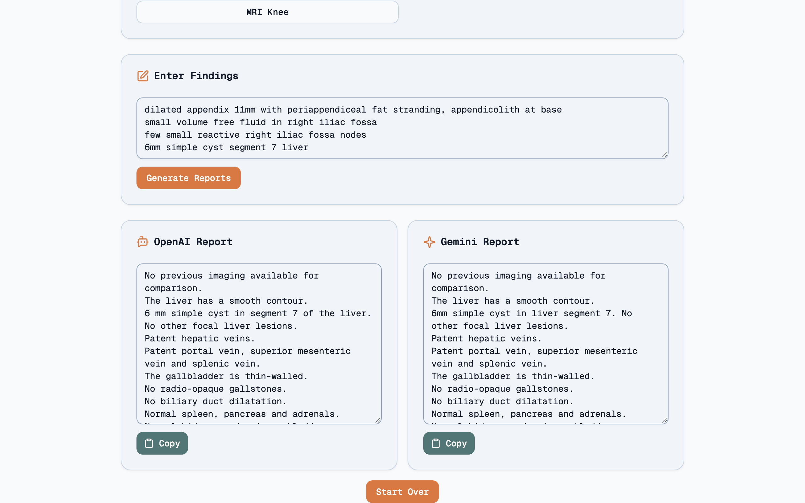
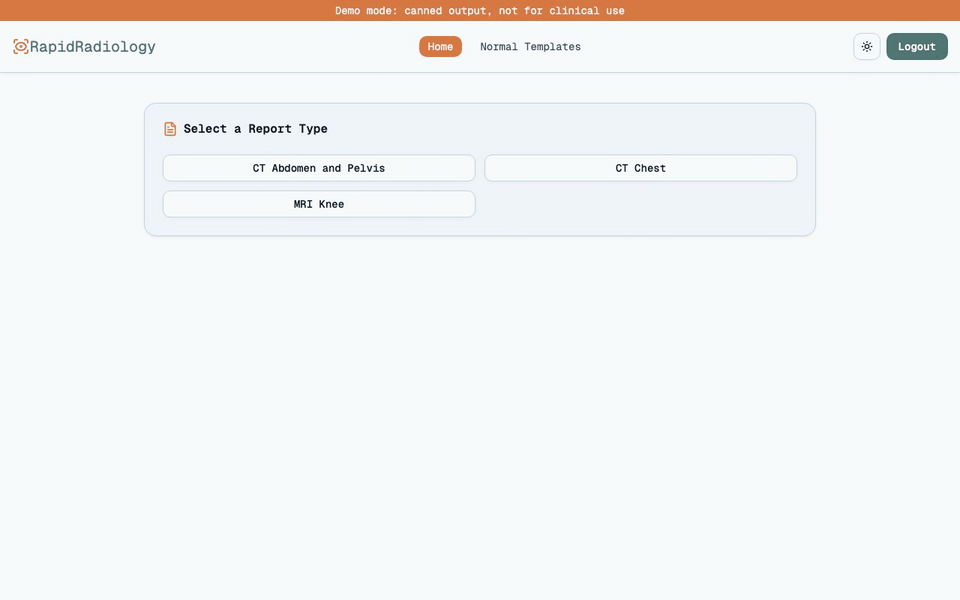
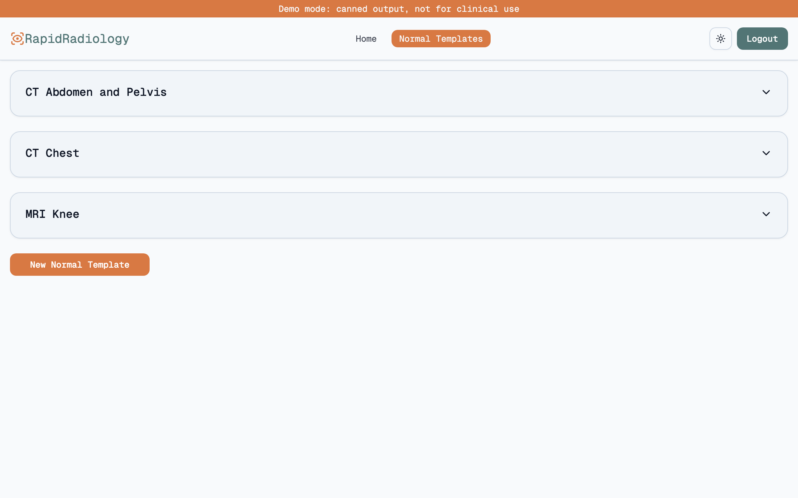
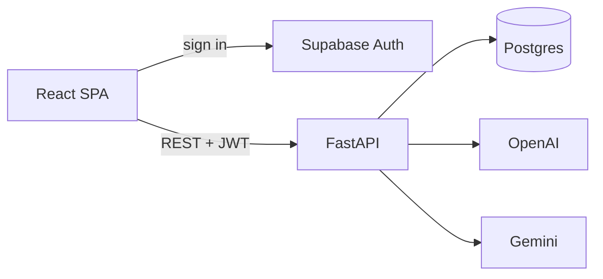

<h1 align="center">RapidRadiology</h1>

<p align="center"><b>Turn a radiologist's shorthand Findings into a finished Report, in their own words.</b></p>

<p align="center">
  <a href="https://shrujancheruku.github.io/rapid-radiology/"></a>
  <a href="LICENSE"></a>
  <a href="https://github.com/shrujancheruku/rapid-radiology/actions/workflows/pages.yml"></a>
</p>

<picture>
  <source media="(prefers-color-scheme: dark)" srcset="docs/images/hero-dark.png">
  <source media="(prefers-color-scheme: light)" srcset="docs/images/hero-light.png">
  
</picture>

> **Try it:** the [live demo](https://shrujancheruku.github.io/rapid-radiology/). Any email and password works. Output is canned; not for clinical use.

## Why

Radiologists dictate the same normal report hundreds of times and change a few lines per study. Each radiologist keeps their own **Normal Template** per **Report Type**. They type only the abnormal **Findings**, and RapidRadiology merges them in: every normal line is kept word for word unless an abnormality replaces it.

## How it works



1. **Pick a Report Type**: CT Chest, MRI Knee, and 18 more.
2. **Type Findings** in your usual shorthand.
3. **Get two Reports**, from OpenAI and Gemini, side by side. Copy the one you prefer.

## Highlights

- **Your template, your wording.** The prompt is built to keep each template line verbatim; only the abnormal lines change.
- **Two models, side by side.** The models really do differ: OpenAI tends to expand shorthand into full sentences, Gemini stays near-verbatim. You choose the output, not the model. ([ADR 0001](docs/adr/0001-generate-with-both-models-side-by-side.md))
- **Comparison-aware.** Mention a prior study date and the Report opens with "Comparison is made to previous imaging dated ...".
- **Normal Templates per Report Type**, edited in the app.
- **Backend-free demo mode.** The same frontend with fake auth and API swapped in at build time, deployed to GitHub Pages. See [docs/demo-mode.md](docs/demo-mode.md).

<picture>
  <source media="(prefers-color-scheme: dark)" srcset="docs/images/templates-dark.png">
  <source media="(prefers-color-scheme: light)" srcset="docs/images/templates-light.png">
  
</picture>

## Architecture



A React SPA authenticates with Supabase, then calls a FastAPI backend that verifies the Supabase JWT, loads the user's Normal Template and asks both models for a Report. More in [docs/architecture.md](docs/architecture.md).

## Tech stack

|          |                                                                      |
| -------- | -------------------------------------------------------------------- |
| Frontend | React 19, TypeScript, Vite, Tailwind CSS 4, shadcn/ui, Framer Motion |
| Backend  | FastAPI, SQLModel, Alembic, PostgreSQL                               |
| Auth     | Supabase Auth (JWT verified in the backend)                          |
| Models   | OpenAI GPT-5, Google Gemini 2.5 Flash                                |
| Hosting  | GitHub Pages (demo)                                                  |

## Run it locally

**Demo mode (no backend, no keys):**

```sh
cd frontend && npm ci && npm run dev:demo
```

**Full stack:** needs a Supabase project plus OpenAI and Gemini API keys.

```sh
cp backend/.env.example backend/.env    # fill in
cd backend && uv sync --locked && uv run fastapi dev main.py
cp frontend/.env.example frontend/.env  # fill in
cd frontend && npm ci && npm run dev
```

Details: [docs/development.md](docs/development.md).

## Disclaimer

Not a medical device. It is not intended for clinical use, and every Report must be reviewed by a qualified radiologist. The demo uses fictional content only.

## License

MIT. See [LICENSE](LICENSE).
