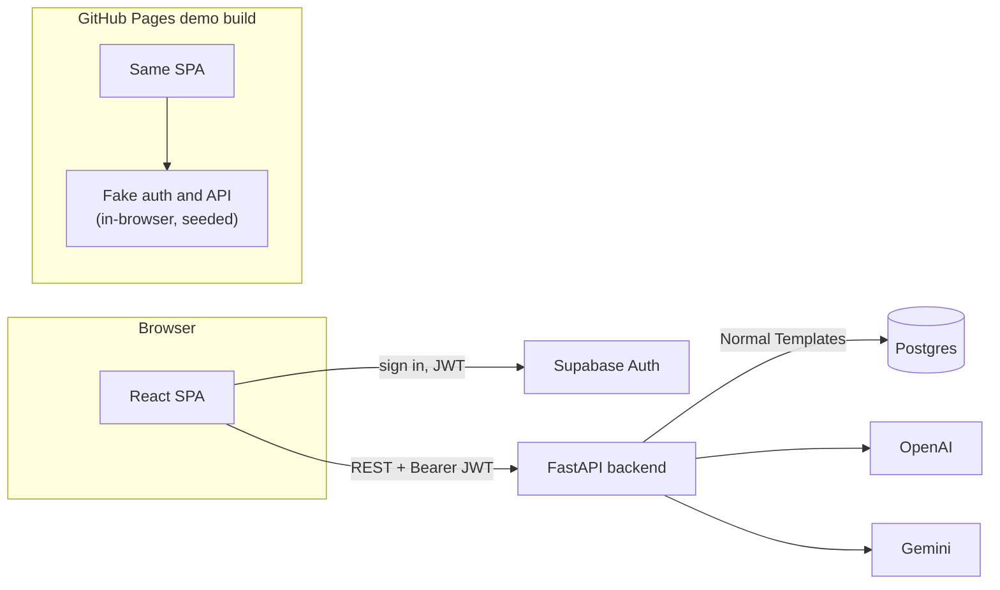
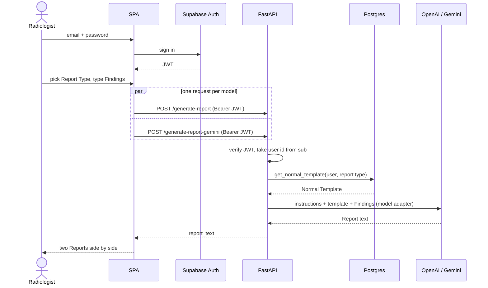

# Architecture

How the system works. For setup see [development.md](development.md); for the demo build see [demo-mode.md](demo-mode.md). Domain terms (Report Type, Normal Template, Findings, Report) are defined in [GLOSSARY.md](../GLOSSARY.md).

## Components

The demo build is the same SPA with the auth and API ports swapped for in-browser fakes at build time; no Supabase, backend or model is involved. See [demo-mode.md](demo-mode.md).

## Generating a Report

The two models run in parallel because the client sends both requests at once; the backend handles each independently. Why both models: [ADR 0001](adr/0001-generate-with-both-models-side-by-side.md). Why the backend, not Supabase, owns the data: [ADR 0002](adr/0002-backend-owns-data-supabase-only-for-auth.md).

## Module map

**Backend** (`backend/`, flat modules)

| Module         | Responsibility                                                               |
| -------------- | ---------------------------------------------------------------------------- |
| `config.py`    | Settings from environment variables (`pydantic-settings`)                    |
| `db.py`        | Engine, session dependency, migrations on startup, `get_normal_template`     |
| `auth.py`      | `get_current_user`: verifies the Supabase JWT, returns the user id           |
| `templates.py` | CRUD routes for Normal Templates, scoped to the caller                       |
| `reports.py`   | The two generate routes and the `ModelAdapter` protocol                      |
| `llm.py`       | OpenAI and Gemini adapters (the only place free-text Findings reach a model) |
| `prompt.py`    | The instructions and `build_content`                                         |
| `models.py`    | SQLModel table, `ReportType` enum, request and response models               |

**Frontend** (`frontend/src/`)

| Path               | Responsibility                                                         |
| ------------------ | ---------------------------------------------------------------------- |
| `backend/`         | The `AuthService` and `Api` ports, plus the Supabase and HTTP adapters |
| `demo/`            | Fake auth, fake API and the seed content for demo mode                 |
| `pages/`           | Login, Home (the three-step flow) and Normal Templates pages           |
| `components/home/` | The Report Type, Findings and Reports steps and the model list         |
| `components/ui/`   | shadcn/ui primitives                                                   |
| `contexts/`        | Auth and theme providers                                               |

## Prompt approach

The model is given the radiologist's whole Normal Template and told to rewrite it with the Findings merged in, keeping every line verbatim unless an abnormality replaces it. Rewriting the whole template (rather than asking for a list of edits) keeps the output a complete Report in the template's own order, and the model handles splitting a normal line around an abnormality. From the instructions in [`backend/prompt.py`](../backend/prompt.py):

> Template line: `Unremarkable small and large bowel.`
> Findings: `inflammatory changes surrounding the appendix`
> Report line: `Inflammatory changes surrounding the appendix. Unremarkable small bowel.`

Two further rules: the first line is always a comparison line (`No previous imaging available for comparison.` unless the Findings give a prior study date), and the Report contains the findings section only, no impression.

## Error contract

| Status | When                                                                        |
| ------ | --------------------------------------------------------------------------- |
| 401    | Missing, malformed, expired or wrongly-signed JWT (`Not authenticated`)     |
| 404    | No Normal Template for that Report Type, or deleting one that doesn't exist |
| 500    | Unhandled server error (for example the database is unreachable)            |
| 502    | The model call failed (`Report generation failed`)                          |

The SPA shows a toast per failed model, so one model failing doesn't hide the other's Report.

## Decisions

- [ADR 0001: Generate with both models, side by side](adr/0001-generate-with-both-models-side-by-side.md)
- [ADR 0002: Backend owns the data; Supabase only for authentication](adr/0002-backend-owns-data-supabase-only-for-auth.md)
- [Demo mode](demo-mode.md)
- [GLOSSARY.md](../GLOSSARY.md)
